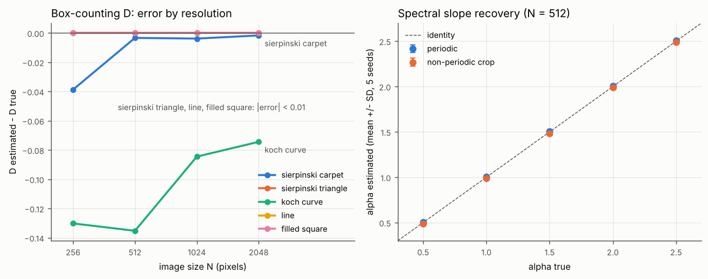
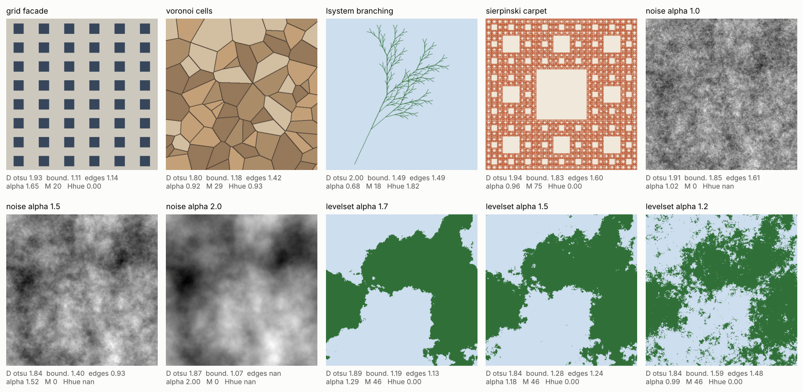
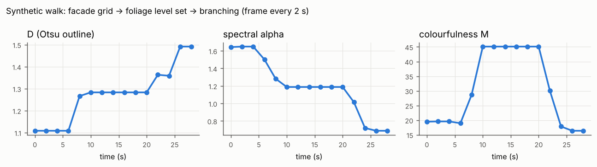
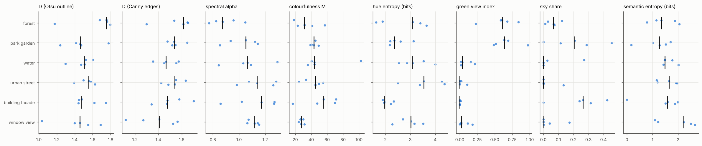
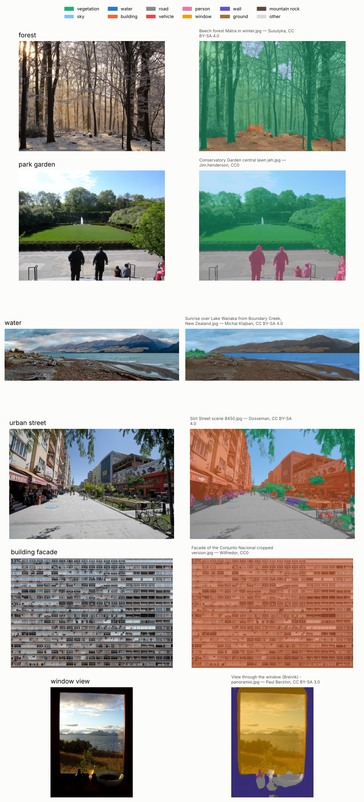

# nature-visual-features

Quantitative, descriptive features of natural visual patterns in images and
video frames: **fractal** (box-counting dimension), **spectral** (Fourier
amplitude-spectrum slope), **semantic** (scene composition from SegFormer /
ADE20K) and **colour** (hue entropy, saturation, colourfulness).

`nvf` is a small Python package with a command-line tool, tests on synthetic
images with known answers, and a reproducible demo. Version 0.1.

## Motivation

Environmental psychology links contact with nature to recovery from stress
and mental fatigue; Attention Restoration Theory (Kaplan, 1995) is one
influential framework. Separately, work on *natural image statistics* and
*fractal fluency* asks which measurable image properties might contribute:

* Natural scenes tend to have Fourier amplitude spectra falling off roughly as
  1/f (Field, 1987).
* Many natural patterns are statistical fractals. In a series of studies by
  Taylor, Spehar and colleagues, observers preferred patterns with mid-range
  fractal dimension (Spehar et al., 2003, report a preference for D around
  1.3–1.5 across natural, mathematical and human-made fractals). Taylor
  (2006) reports preliminary evidence that viewing mid-range fractals reduces
  physiological stress. The research is reviewed in Taylor et al. (2011).
* In a landscape study, the fractal dimension of skyline silhouettes was
  related to preference (Hagerhall et al., 2004).
* Urban greenery research uses the share of vegetation visible in street-level
  images, the "green view" (Yang et al., 2009).

This package computes such features in a transparent, validated way, so they
can serve as descriptors of window views, facades, virtual environments or
first-person video in environment-and-health studies. **The features are
descriptive. They are not measures of restoration, preference or wellbeing**;
any such link has to be tested in a study design.

## Install

```bash
pip install -e .                 # core: numpy, scipy, scikit-image, opencv-python-headless, pandas
pip install -e ".[semantic]"     # + torch, torchvision, transformers (SegFormer)
pip install -e ".[dev]"          # + pytest, ruff, matplotlib (tests and demo figures)
```

Requires Python ≥ 3.11. CI runs the tests on 3.11 and 3.12.

## Usage

```bash
nvf images path/to/images --out features.csv              # one row per image
nvf images path/to/images --out features.csv --semantic   # + SegFormer features
nvf video walk.mp4 --every 5 --out frames.csv             # one row per sampled frame
                                                          # + frames_summary.csv (mean, SD)
```

Images are downscaled (never upscaled) so that the long side is at most 1024 px
(`--max-side`; 0 disables), because D and α depend on resolution. The output
records original and working sizes.

From Python:

```python
from nvf.imageio import load_rgb
from nvf.pipeline import extract_features
from nvf.fractal import fractal_dimension_boundary

img = load_rgb("view.jpg")
features = extract_features(img)          # dict of all non-semantic features
res = fractal_dimension_boundary(img)     # D, R², box sizes and counts
```

## Feature definitions

### Fractal dimension (`nvf.fractal`)

Box counting: N(s) is the number of s × s boxes (grid anchored at the top-left,
zero-padded edges) that contain at least one foreground pixel, and D is minus
the OLS slope of log N(s) on log s:

  log N(s) = −D · log s + c

**Fit range:** s = 2, 4, 8, … ≤ min(H, W)/8. Size 1 is excluded (pixel
discretisation), and sizes above 1/8 of the image are excluded (fewer than 8×8
boxes, saturated counts). Each result reports D, the R² of the log–log fit,
and the smallest and largest box sizes used.

Three binary maps are derived from luminance (BT.601):

| column | binary map | note |
|---|---|---|
| `fd_otsu` | pixels above the Otsu (1979) threshold | box-counting a filled region tends to 2; measures the **bright** phase |
| `fd_boundary` | one-pixel outline of the Otsu mask | no smoothing parameter; outline of the binarised pattern |
| `fd_edges` | Canny (1986) edges, σ = 2 px, scikit-image default thresholds (0.1 / 0.2 of the luminance range) | also detects texture and shading edges; NaN when there are no edges |

### Spectral slope (`nvf.spectral`)

The amplitude spectrum is fitted as A(f) ∝ 1/f^α. Steps: take luminance; crop
the central square (N × N); subtract the mean; apply a 2-D Hann window; take
the FFT amplitude; average radially in rings of 1 cycle/image; fit
log A = −α · log f + c by OLS over **8 ≤ f ≤ N/4 cycles/image**. The lower
bound avoids the frequencies most affected by the window, and the upper bound
avoids aliasing, noise and compression artefacts. Outputs: `spec_alpha`,
`spec_r2`, and the fit range.

The deviation-from-natural-spectrum index used in the visual-discomfort
literature (Penacchio & Wilkins, 2015) is **not** included. I could not check
its exact definition (fit, weighting) against the original paper in this
release, and an approximate re-implementation under that name would be
misleading.

### Colour (`nvf.colour`)

* `hue_entropy`: H = −Σ p_k log₂ p_k over 36 hue bins (10°) of the pixels with
  saturation ≥ 0.2 **and** value ≥ 0.2 (OpenCV HSV, S and V in [0, 1]). Hue is
  undefined for grey pixels and unstable for dark ones. `hue_entropy_norm`
  divides by log₂ 36; `hue_valid_fraction` is the share of pixels used (NaN
  entropy if none).
* `mean_saturation`, `mean_value`: means over all pixels.
* `colourfulness` (Hasler & Süsstrunk, 2003): on 8-bit sRGB, with rg = R − G
  and yb = ½(R + G) − B,
  M = √(σ_rg² + σ_yb²) + 0.3 · √(μ_rg² + μ_yb²).

### Semantic composition (`nvf.semantic`, optional)

The image is segmented with SegFormer-B0 fine-tuned on ADE20K
(`nvidia/segformer-b0-finetuned-ade-512-512`; Xie et al., 2021; Zhou et al.,
2017) on CPU. Logits are upsampled to at most 512 px on the long side before
the argmax. The 150 ADE20K classes are mapped to 11 groups plus `other` by
the readable table [`src/nvf/data/ade20k_groups.csv`](src/nvf/data/ade20k_groups.csv):

| group | ADE20K classes |
|---|---|
| vegetation | tree, grass, plant, field, flower, palm |
| sky | sky |
| water | water, sea, river, waterfall, lake, swimming pool, fountain |
| building | building, house, skyscraper, tower, hovel, awning, column |
| road | road, sidewalk, path, runway, dirt track |
| vehicle | car, boat, bus, truck, airplane, van, ship, minibike, bicycle |
| person | person |
| window | windowpane |
| wall | wall |
| ground | earth, sand, land |
| mountain_rock | mountain, rock, hill |
| other | the remaining 106 classes (floor, fence, ceiling, furniture, …) |

Outputs: `sem_share_<group>` (sums to 1), `green_view_index` (vegetation
share), `sky_view_share` (sky share of the image, **not** the hemispherical sky
view factor), and `sem_entropy` = −Σ p_g log₂ p_g over the 12 groups (maximum
3.58 bits). When the model loads, its `id2label` is checked against the table.

### Video (`nvf.video`)

`nvf video` reads frames sequentially with OpenCV and keeps frame
round(k · every · fps) for k = 0, 1, … (exact for codecs with sparse
keyframes). Each kept frame gets the image features above. The summary file
gives the mean and SD (ddof = 1) per feature and the number of non-missing
frames.

## Validation

All numbers below come from `python scripts/validate.py` (outputs in
[`results/`](results/)). The same checks, with tolerances, run in CI.



**Box-counting D on patterns with known dimension** (default fit range;
minimum R² across sizes in the last column):

| pattern | D true | N=256 | N=512 | N=1024 | N=2048 | min R² |
|---|---|---|---|---|---|---|
| filled square | 2.000 | 2.000 | 2.000 | 2.000 | 2.000 | 1.000 |
| Sierpinski carpet | 1.893 | 1.854 | 1.889 | 1.889 | 1.891 | 0.9995 |
| Sierpinski triangle | 1.585 | 1.585 | 1.585 | 1.585 | 1.585 | 1.000 |
| Koch curve | 1.262 | 1.132 | 1.127 | 1.177 | 1.187 | 0.998 |
| straight line | 1.000 | 1.000 | 1.000 | 1.000 | 1.000 | 1.000 |

* The dyadic patterns (triangle, line, square) are recovered exactly. The
  carpet is within 0.004 from N = 512 upwards, and its error at N = 256 is −0.039.
* **The Koch curve is underestimated by 0.07–0.14.** Its local log–log slopes
  oscillate between about 0.97 and 1.33 (a triadic fractal on a dyadic box
  grid), and the curve covers only about 28 % of the frame height. The result
  depends on the fit range. At N = 1024, the error is −0.023 with
  s ≤ 32, −0.069 with s ≤ 64, −0.084 with s ≤ 128 (default) and −0.044 with
  s ≤ 256 (`results/validation_fractal_fitrange.csv`). The default was not
  tuned to these patterns.
* A square outline has a −4 corner term in N(s) = 4L/s − 4, so its
  `fd_boundary` is 1.06 rather than 1.00 over the default range.

**Spectral slope α on 1/f^α noise** (α = 0.5–2.5, 5 seeds per cell):

| N | periodic image: bias | non-periodic crop: bias | max SD | max \|error\| |
|---|---|---|---|---|
| 256 | −0.051 … −0.044 | +0.024 … +0.034 | 0.039 | 0.093 |
| 512 | +0.005 … +0.008 | −0.015 … −0.011 | 0.014 | 0.034 |
| 1024 | −0.006 … −0.005 | −0.002 … +0.001 | 0.008 | 0.012 |

The same five noise realisations are used for every α, so the bias is almost
the same across α. It reflects these realisations and the finite fit range,
not an α-dependent estimator bias.

**Outlines of level sets of 1/f^α noise.** The outline of a level set of such
a surface has D = 3 − α in the limit of infinite resolution (Voss, 1988).
Median threshold, mean D over 5 seeds:

| α | expected | boundary (512 / 1024) | Canny σ=1 (512 / 1024) | Canny σ=2 (512 / 1024) |
|---|---|---|---|---|
| 1.2 | 1.8 | 1.660 / 1.702 | 1.681 / 1.719 | 1.589 / 1.644 |
| 1.4 | 1.6 | 1.468 / 1.512 | 1.482 / 1.522 | 1.411 / 1.464 |
| 1.6 | 1.4 | 1.302 / 1.340 | 1.304 / 1.343 | 1.256 / 1.307 |
| 1.8 | 1.2 | 1.171 / 1.202 | 1.174 / 1.202 | 1.147 / 1.181 |

All outline estimators **underestimate high D**. The Otsu outline and Canny
σ = 1 err by up to 0.14 at 512 px and 0.10 at 1024 px; the smoother default
Canny (σ = 2) errs by up to 0.21 and 0.16. The bias shrinks with resolution. Absolute D values from different resolutions
or pipelines should therefore not be compared. Relative comparisons within
one pipeline are safer.

Colour metrics are tested on constructed images: grey → 0 colourfulness and no
valid hue; four equal hues → 2 bits; a full hue wheel → log₂ 36; hand-computed
Hasler–Süsstrunk M. Semantic grouping is tested with fake label maps and a
mocked segmenter.

## Demo results

`python scripts/run_demo.py` needs no network access (about 6 s on the CPU-only
build machine).

**Procedural facade-like patterns** (`scripts/make_patterns.py`, 512 × 512,
`results/pattern_features.csv`):



| pattern | D otsu | D boundary | D edges | α | hue entropy | colourfulness |
|---|---|---|---|---|---|---|
| grid facade | 1.93 | 1.11 | 1.14 | 1.65 | 0.00 | 19.7 |
| Voronoi cells | 1.80 | 1.18 | 1.42 | 0.92 | 0.93 | 28.6 |
| L-system branching | 2.00 | 1.49 | 1.49 | 0.68 | 1.82 | 18.5 |
| Sierpinski carpet | 1.94 | 1.83 | 1.60 | 0.96 | 0.00 | 75.5 |
| noise α=1.0 (grey) | 1.92 | 1.85 | 1.61 | 1.02 | – | 0.0 |
| noise α=1.5 (grey) | 1.84 | 1.40 | 0.93 | 1.52 | – | 0.0 |
| noise α=2.0 (grey) | 1.87 | 1.07 | – | 2.00 | – | 0.0 |
| level set α=1.7 (2-tone) | 1.88 | 1.19 | 1.12 | 1.29 | 0.00 | 45.9 |
| level set α=1.5 (2-tone) | 1.84 | 1.28 | 1.24 | 1.18 | 0.00 | 45.9 |
| level set α=1.2 (2-tone) | 1.84 | 1.59 | 1.48 | 0.99 | 0.00 | 45.9 |

What the gallery shows:
* **`fd_otsu` hardly separates the patterns** (1.80–2.00), because it counts
  a filled phase. For the L-system it measures the bright **sky**, not the
  branches (D = 2.00). The outline-based measures separate the patterns better.
* **Canny edges miss smooth structure.** At the absolute thresholds,
  α = 1.5 noise gives very few edges (D 0.93) and α = 2.0 noise gives none (NaN).
* **Binarising changes the spectrum.** The two-tone level sets have
  α ≈ 1.0–1.3 rather than the α of the noise they were cut from.
* A regular window grid has a low outline D (1.11) and a poorly fitting
  spectrum (R² 0.76), because its energy sits at a few harmonics instead of
  following a power law.
* Hue entropy is 0 for two-tone images: the pale sky colour falls below the
  saturation mask (S ≈ 0.14 < 0.2), so only the green counts.

**Synthetic video.** A 30 s, 5 fps video cross-fades from the facade grid to
the α = 1.5 level set and then to the branching pattern. `nvf.video` samples it
every 2 s (`results/demo_video_*.csv`):



**Wikimedia Commons photographs.** `scripts/fetch_examples.py` took the
first five usable search results in each of six categories: JPEG only,
CC0 / CC BY / CC BY-SA, no extra restrictions, wider than 1280 px. That is
30 photographs, listed with author, licence and source in
[`examples/ATTRIBUTION.csv`](examples/ATTRIBUTION.csv). They were analysed
at 1024 px on the long side by `python scripts/run_demo.py --semantic`
(per-image values in `results/example_features.csv`). Medians per category
(n = 5 each; `results/example_summary_by_category.csv`):

| category | D boundary | D edges | α | green view index | sky share | semantic entropy (bits) | hue entropy (bits) | colourfulness |
|---|---|---|---|---|---|---|---|---|
| forest | 1.75 | 1.61 | 0.87 | 0.61 | 0.07 | 1.34 | 3.09 | 31.6 |
| park / garden | 1.46 | 1.54 | 1.05 | 0.64 | 0.21 | 1.28 | 2.36 | 43.5 |
| water (lake shore) | 1.51 | 1.46 | 1.07 | 0.04 | 0.00 | 1.48 | 3.09 | 44.2 |
| urban street | 1.56 | 1.54 | 1.14 | 0.00 | 0.00 | 1.65 | 3.54 | 45.2 |
| building facade | 1.48 | 1.48 | 1.17 | 0.00 | 0.26 | 1.59 | 1.97 | 55.5 |
| window view | 1.46 | 1.41 | 1.12 | 0.02 | 0.00 | 2.22 | 3.02 | 27.3 |



How to read this:
* **Forest stands apart on the image statistics.** It has the highest
  outline D (1.75) and the lowest α (0.87), i.e. more fine-scale structure,
  but four of its five photos show leafless or winter trees and one is a
  close-up of a frog (D 1.17).
* **Elsewhere, within-category spread swamps the differences.** The other
  five categories differ in median D by at most 0.10 and in median α by at
  most 0.12. Spread within a category is larger: outline D runs from 1.03 to
  1.69 for window views.
* **Green view index and sky share mostly separate categories.** Vegetated
  scenes come out at about 0.6 and built scenes at 0, as expected. For
  window views, though, the near-zero values are largely a segmentation
  failure (see below), and so is part of their high semantic entropy.
* **Colourfulness of facades says more about the sample than about
  facades.** Three of the five come from one photographer's series
  ("Freopedia"), two of them of the same building, all under a deep-blue
  sky. Two window views show the same temple.
* **These are not representative samples of the categories.** They are
  whatever a keyword search returned: one "water" photo is an aerial view
  of high-rise towers on a lakefront, another a satellite image of Lake
  MacKay. The numbers show that the pipeline runs on real photographs and
  what it returns; they are not evidence about the categories.

**Segmentation check.** `python scripts/segmentation_overlays.py` writes the
SegFormer group labels over every photograph (`data/overlays/`, git-ignored).
All 30 overlays were inspected. One example per category (CC BY-SA panels
remain under CC BY-SA; credits under each panel):



Errors seen across the 30 images:

* **Views through glass are labelled as glass.** In *View through the window
  (Breivik)* the whole view (sky, sea, mountains, shrubs) is one
  `windowpane` region (65 % of the image). Green view index and sky share
  are both 0.00. In a porthole view of a railway yard, a forested hillside
  is labelled `mountain` and partly `windowpane`.
* **"Vegetation" follows tree shapes, not green leaves.**
  * Leafless winter canopies, including the sky between the branches, are
    labelled `tree`: *Beech forest Mátra in winter* has a green view index
    of 0.84 with almost no green.
  * Behind the trunks at Hald Sø, the lake is also labelled `tree`.
  * Sunlit scrub seen from a distance becomes `earth`/`land`: the
    scrub-covered hills in *View through a stone window* give a green view
    index of 0.02.
* **Surfaces are confused by texture.**
  * The bark of old oak trunks becomes `wall` (21 %) and `rock`/`mountain`
    (34 %), so the Epping Forest photo, which is nearly all tree, has a
    green view index of 0.23.
  * Bare, sunlit dusty ground seen through a temple window becomes `water`
    (17 %).
  * A driftwood and shingle beach (Lake Wanaka) becomes `mountain`.
  * Floating water lettuce on a lake edge is absorbed into `water`.
* **Facades are labelled as one block of `building`.**
  * On the fully glazed *Conjunto Nacional* facade, 100 % of the image is
    `building` and 0 % `windowpane`, so window share is not a glazing ratio.
  * The same brick piers are split arbitrarily between `building` and `wall`.
  * Shop windows and their displays are `building`; dark glass towers break
    up into `other` (box, ashcan).
* **Out-of-domain images fail.** On a satellite image (Lake MacKay), ochre
  islands become `building` and the salt crust `mountain` (72 %). On the
  frog close-up, the frog is `person` and the blurred background `water`.
* **What works.** Lawns, trees in leaf, sky, open water, roads, sidewalks,
  people and vehicles in ordinary street-level and garden scenes are
  segmented well (e.g. Conservatory Garden, the Siirt and Kharkiv streets,
  the canal at the General Staff Building).

To reproduce the photo results exactly, re-download the recorded files and
rerun:

```bash
python scripts/fetch_examples.py --from-attribution examples/ATTRIBUTION.csv
python scripts/run_demo.py --semantic
python scripts/segmentation_overlays.py --figure <one file per category>
```

Wikimedia rate-limits shared IP addresses (HTTP 429 with `Retry-After` up
to 600 s, stricter for original files than for standard thumbnail sizes).
The fetcher waits as told and skips files it already has, so rerun it until
it reports no skipped files.

## Limitations

* **D depends on choices.** It depends on the binarisation (threshold, which
  phase, filled vs. outline vs. edges), on image resolution and on the fit
  range, as the tables above show. Report D together with its R², the scale
  range and the working resolution, and compare like with like.
* **Box counting is a simple estimator.** It uses a single grid placement
  (no offset minimisation), power-of-two scales and unweighted OLS. Images
  are not ideal fractals: D summarises scaling over a finite range.
* **The spectral slope is a single number for the whole image.** It averages
  orientations and assumes a power law over 8–N/4 cycles/image. Windowing,
  JPEG compression, sensor noise, defocus and vignetting all affect it.
  Check `spec_r2`.
* **Colour metrics are in device sRGB.** They are not calibrated colorimetry.
  The hue-entropy mask thresholds (S, V ≥ 0.2) are a convention, not a
  standard.
* **The semantic features have known gaps.** ADE20K and SegFormer-B0 are a
  small, general-purpose model and dataset, with domain gaps for close-up
  vegetation, facade materials, views through glass, night scenes, VR
  renderings and head-mounted first-person video. The group mapping involves
  judgement (e.g. *field*, *fountain*, *dirt track*). Image-level shares are
  not the hemispherical green view or sky view factor. Visual inspection of
  30 Commons photographs (no pixel-level ground truth, so no accuracy
  figure) found systematic errors (section "Demo results"):
  * the view through a window is labelled `windowpane`, so green view index
    and sky share of window views are near zero;
  * leafless canopies count as vegetation, while distant scrub counts as
    `earth`;
  * bark becomes `wall`/`rock`, and dusty ground can become `water`;
  * facades, glazing included, are one `building` region;
  * aerial and close-up images fail.

  Check overlays before using these features on a new kind of image.
* **The features are descriptive.** They are not validated measures of
  restoration, preference, stress or thermal perception.

## Repository layout

```
src/nvf/           fractal.py spectral.py colour.py semantic.py video.py pipeline.py cli.py
src/nvf/data/      ade20k_groups.csv (ADE20K → group mapping)
scripts/           validate.py make_patterns.py fetch_examples.py run_demo.py segmentation_overlays.py
tests/             pytest suite (synthetic data only, no network)
results/           validation and demo tables and figures (committed)
examples/          ATTRIBUTION.csv for downloaded example images (images themselves in data/, git-ignored)
```

## References

* Canny, J. (1986). A computational approach to edge detection. *IEEE Transactions on Pattern Analysis and Machine Intelligence*, PAMI-8(6), 679–698. https://doi.org/10.1109/TPAMI.1986.4767851
* Field, D. J. (1987). Relations between the statistics of natural images and the response properties of cortical cells. *Journal of the Optical Society of America A*, 4(12), 2379–2394. https://doi.org/10.1364/JOSAA.4.002379
* Hagerhall, C. M., Purcell, T., & Taylor, R. (2004). Fractal dimension of landscape silhouette outlines as a predictor of landscape preference. *Journal of Environmental Psychology*, 24(2), 247–255.
* Hasler, D., & Süsstrunk, S. (2003). Measuring colorfulness in natural images. *Proc. SPIE 5007, Human Vision and Electronic Imaging VIII*, 87–95. https://doi.org/10.1117/12.477378
* Kaplan, S. (1995). The restorative benefits of nature: Toward an integrative framework. *Journal of Environmental Psychology*, 15(3), 169–182. https://doi.org/10.1016/0272-4944(95)90001-2
* Otsu, N. (1979). A threshold selection method from gray-level histograms. *IEEE Transactions on Systems, Man, and Cybernetics*, 9(1), 62–66. https://doi.org/10.1109/TSMC.1979.4310076
* Penacchio, O., & Wilkins, A. J. (2015). Visual discomfort and the spatial distribution of Fourier energy. *Vision Research*, 108, 1–7. https://doi.org/10.1016/j.visres.2014.12.013 (cited only to explain an omission)
* Prusinkiewicz, P., & Lindenmayer, A. (1990). *The Algorithmic Beauty of Plants*. Springer.
* Spehar, B., Clifford, C. W. G., Newell, B. R., & Taylor, R. P. (2003). Universal aesthetic of fractals. *Computers & Graphics*, 27(5), 813–820. https://doi.org/10.1016/S0097-8493(03)00154-7
* Taylor, R. P. (2006). Reduction of physiological stress using fractal art and architecture. *Leonardo*, 39(3), 245–251. https://doi.org/10.1162/leon.2006.39.3.245
* Taylor, R. P., Spehar, B., Van Donkelaar, P., & Hagerhall, C. M. (2011). Perceptual and physiological responses to Jackson Pollock's fractals. *Frontiers in Human Neuroscience*, 5, 60. https://doi.org/10.3389/fnhum.2011.00060
* Voss, R. F. (1988). Fractals in nature: From characterization to simulation. In H.-O. Peitgen & D. Saupe (Eds.), *The Science of Fractal Images* (pp. 21–70). Springer.
* Xie, E., Wang, W., Yu, Z., Anandkumar, A., Alvarez, J. M., & Luo, P. (2021). SegFormer: Simple and efficient design for semantic segmentation with transformers. *Advances in Neural Information Processing Systems*, 34.
* Yang, J., Zhao, L., McBride, J., & Gong, P. (2009). Can you see green? Assessing the visibility of urban forests in cities. *Landscape and Urban Planning*, 91(2), 97–104. https://doi.org/10.1016/j.landurbplan.2008.12.004
* Zhou, B., Zhao, H., Puig, X., Fidler, S., Barriuso, A., & Torralba, A. (2017). Scene parsing through ADE20K dataset. *Proc. IEEE CVPR*, 633–641.

## Licence

MIT (see `LICENSE`). Example images fetched by the demo keep their own
licences, recorded in `examples/ATTRIBUTION.csv`. The MIT licence does not
cover `results/figures/segmentation_overlays.png`: each of its panels is
derived from a Commons photograph and stays under that photograph's licence
(CC0, or CC BY-SA 3.0 / 4.0), with the credit printed above it.
